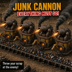

# WePlay: Junk Cannon

**Everything must go!** An early-game Factorio defense that turns your trash into ammo.

The Junk Cannon is a burner furnace with a big cannon bolted on top. Feed it fuel and junk, and it bakes the junk into shells and fires them at any enemies in range. It's unlocked from the start, so it covers you before you've set up proper ammo production.

**[Download on the Factorio Mod Portal](https://mods.factorio.com/mod/WePlayJunkCannon)**

## Features

- **Unlocked from the start.** Recipe: 8 iron plates, 4 iron gears, 1 stone furnace.
- **Eats (almost) anything.** Every item from every mod can become a shell: ore, stone, spare belts, old buildings, leftover intermediates...
- **Burner powered.** Burns coal, wood, solid fuel or any other chemical fuel.
- **Fuel stays fuel.** Fuel only goes in the burner slot and is never baked into shells, so a mixed chest or belt feeds the cannon properly. Turn on **Fuel can be used as junk** in the startup settings if you want to shoot your fuel too.
- **Keeps a stockpile.** Stores up to 10 shells, plus one loaded in the cannon. When it's full, the furnace stops with "Output full". Shells that are already baked still fire after the fuel runs out.
- **Shells stay in the cannon.** Junk Shells are only for the Junk Cannon: inserters and loaders can't take them out, and any you grab by hand go straight back in.
- **Hand-rendered art.** A 64-direction cannon head with shadows, animated flames in the furnace window while it bakes, a smoke puff when it fires, and its own cannon sound.
- **Blueprint friendly.** Ghosts from blueprints, copy-paste and undo show the cannon head too.
- **Mod friendly.** Shell recipes are generated after all other mods load, so modded items work automatically.

## Ideas for feeding it

- **Tap an ore line.** Put an inserter between the cannon and a belt of iron, copper or stone.
- **Clean out your junk.** Early-game buildings you've replaced, extra stone, spare intermediates.
- **Mixed chests and belts.** Coal goes to the burner, everything else becomes ammo.
- **Fulgora scrap.** Turn scrap overflow into firepower.

## Settings

All startup settings:

| Setting | Default | What it does |
|---|---|---|
| Shell damage | 5 | Physical damage per shell |
| Fire cooldown | 120 ticks | Ticks between shots (60 ticks = 1 second) |
| Cannon range | 13 tiles | How far the cannon can shoot |
| Seconds to bake one shell | 2 | How long the furnace takes per item |
| Fuel can be used as junk | Off | Lets fuel be baked into shells |

## Good to know

- The input slot holds one item type at a time.
- Item quality is ignored, so a legendary item makes a normal shell.
- Mining a Junk Cannon deletes any shells inside it. You get the cannon back, but not the ammo.
- Area damage (spitter acid, explosions) can hit a cannon twice: once directly and once through its hidden turret.
- Requires Factorio 2.1.

## How it works

The cannon is two entities: a furnace that you see and interact with, and a hidden turret on top of it.

- `data-final-fixes.lua` generates a hidden "1 item → 1 junk shell" recipe for every item in the game, skipping burner fuels unless the setting is on.
- `control.lua` pairs each furnace with its turret, moves shells from the furnace output into the turret one at a time, and passes damage taken by the turret on to the furnace, so the cannon can be destroyed. It also keeps Junk Shells out of player inventories and draws the cannon head on ghosts.
- `graphics/sprites.lua` holds the sprite sizes and shifts for the rendered sheets, so `data.lua` never needs editing when the art is re-rendered.

## Installation

Install it from the in-game mod manager: search for **Junk Cannon**. Or download it from the [mod portal](https://mods.factorio.com/mod/WePlayJunkCannon).

To run it from source, copy this repo into your Factorio `mods` folder as `WePlayJunkCannon`.

## Upgrading from 0.1.x

Versions before 0.2.1 were named `weplay-junk-cannon`. Back up your save first. Old chest-style cannons become furnaces, and any extra stacks they held are spilled on the ground, never deleted.

## Art

The cannon was modeled and rendered in Blender by the author.

## More WePlay mods

See all of them on the [mod portal](https://mods.factorio.com/user/afewvowels).

## License

Released under the [Unlicense](LICENSE): the code is in the public domain, so do whatever you like with it.
